

  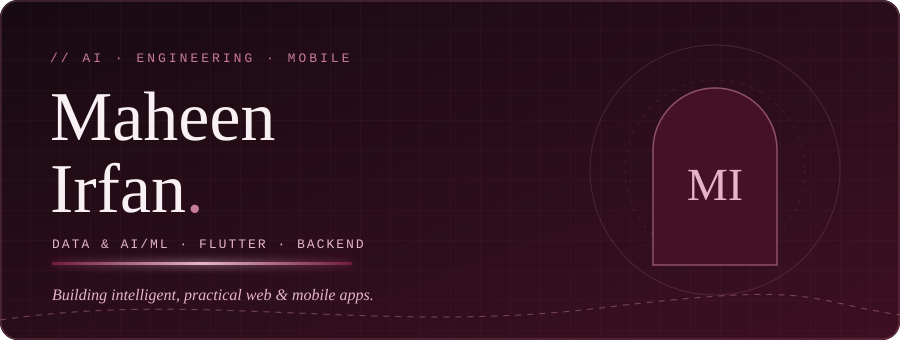

 

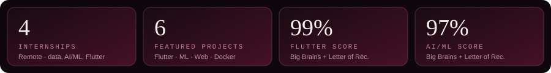

 

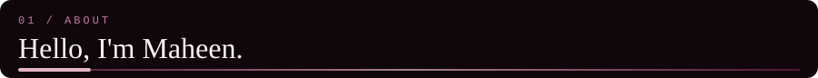

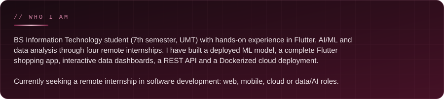

<table>
<tr>
<td width="50%">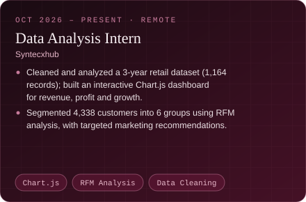</td>
<td width="50%">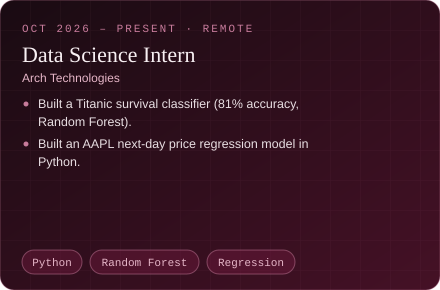</td>
</tr>
<tr>
<td width="50%">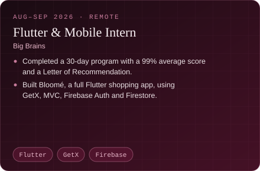</td>
<td width="50%">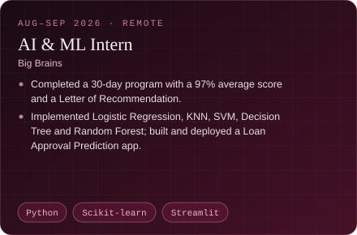</td>
</tr>
</table>

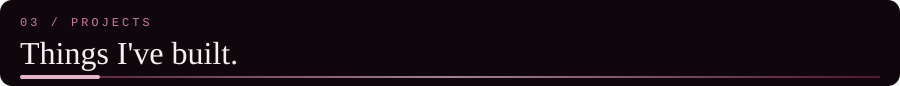

<table>
<tr>
<td width="50%"><a href="https://github.com/maheenawan-dev/bloome-flower-bouquet-app">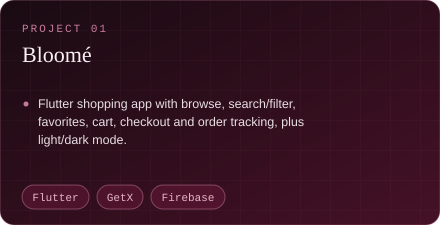</a></td>
<td width="50%"><a href="https://github.com/maheenawan-dev/loan-approval-prediction">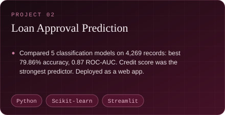</a></td>
</tr>
<tr>
<td width="50%"><a href="https://github.com/maheenawan-dev/budgetlens-project1">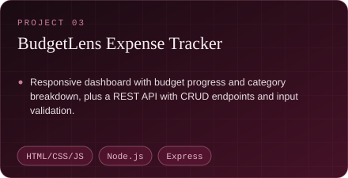</a></td>
<td width="50%"><a href="https://github.com/maheenawan-dev/AIFaceMaskDetection">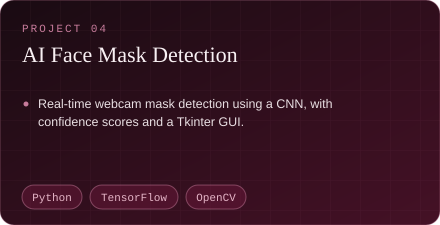</a></td>
</tr>
<tr>
<td width="50%"><a href="https://github.com/maheenawan-dev/dockerized-2048-game">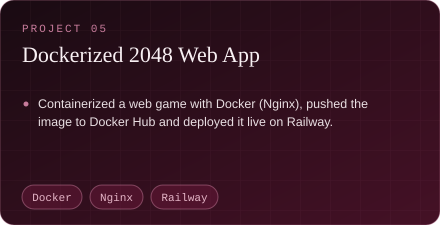</a></td>
<td width="50%"><a href="https://github.com/maheenawan-dev/Travel-site">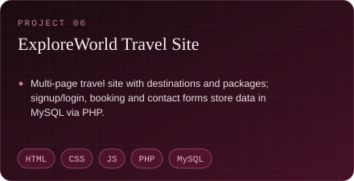</a></td>
</tr>
</table>

**Live demos:** [Loan Approval Prediction](https://loan-approval-prediction-c7vvrpwaahhv7q7uvuoeka.streamlit.app) · [Dockerized 2048](https://t48-production-3b2b.up.railway.app) · **More code:** [BudgetLens API](https://github.com/maheenawan-dev/budgetlens-api-project2) · [Data Science work](https://github.com/maheenawan-dev/datascience-internship-month1)

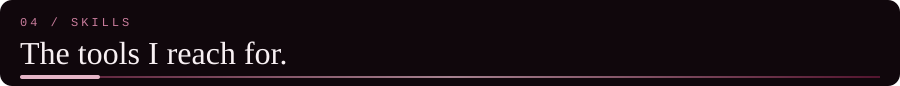

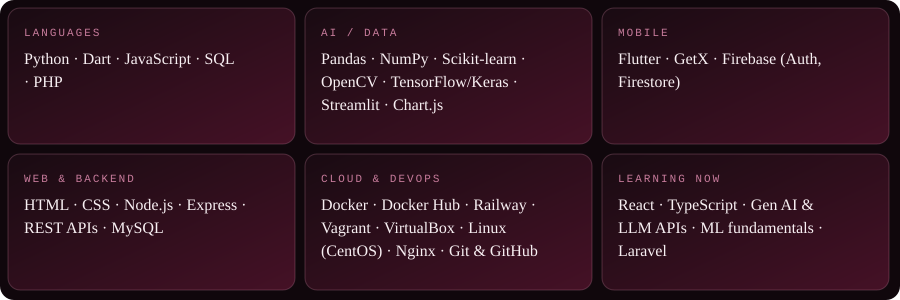

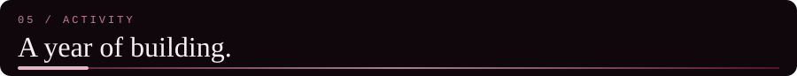

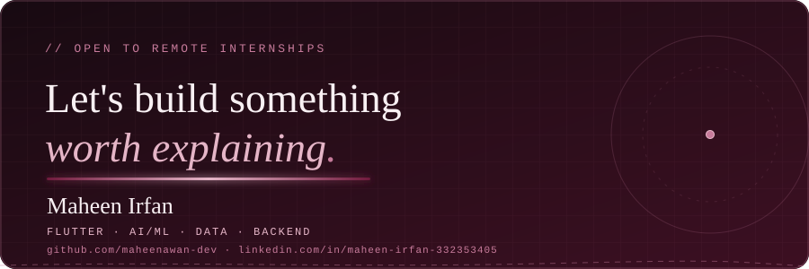
