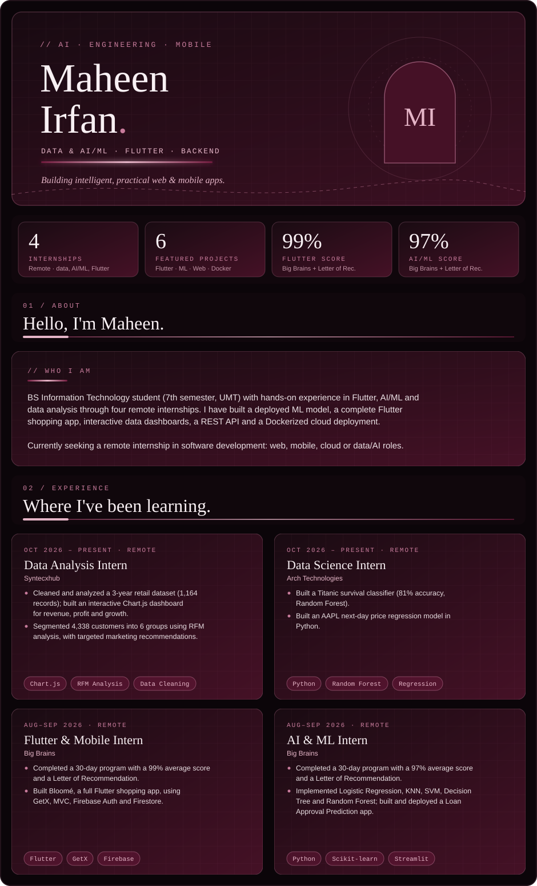
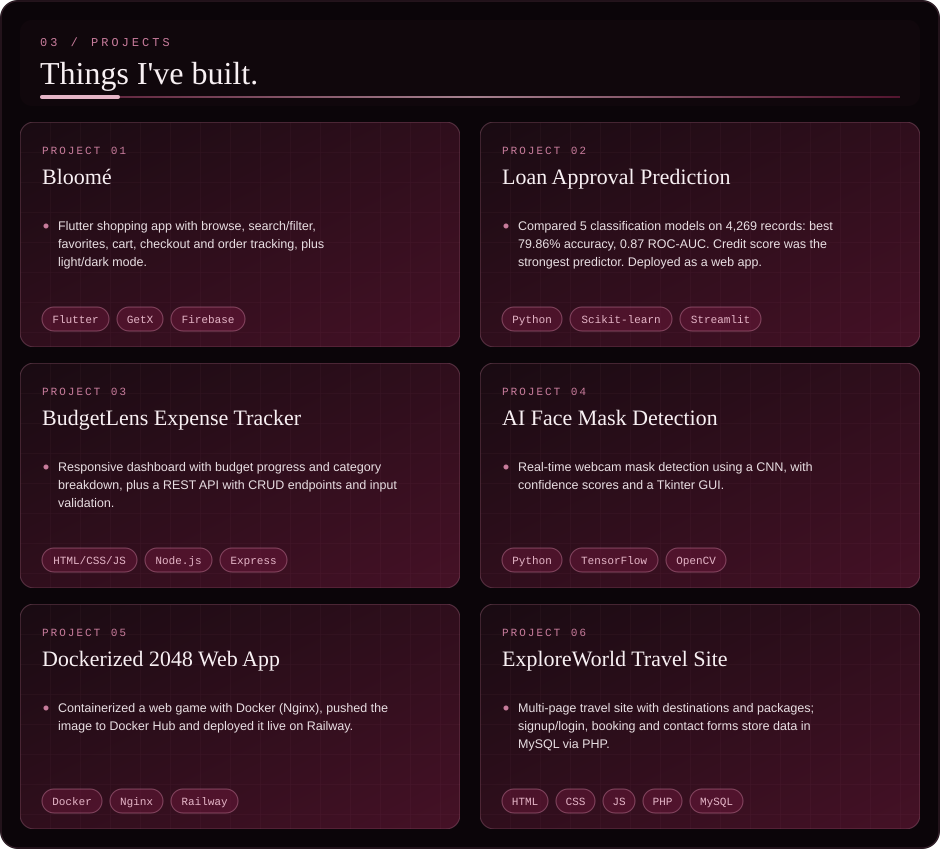
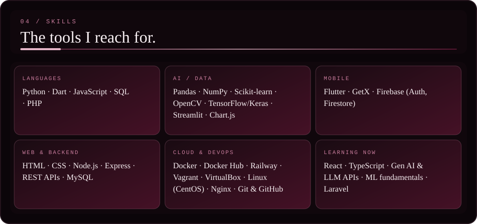
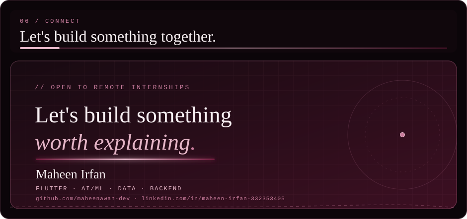

**Open the code:** [Bloomé](https://github.com/maheenawan-dev/bloome-flower-bouquet-app) · [Loan Approval](https://github.com/maheenawan-dev/loan-approval-prediction) · [BudgetLens](https://github.com/maheenawan-dev/budgetlens-project1) · [Face Mask Detection](https://github.com/maheenawan-dev/AIFaceMaskDetection) · [Dockerized 2048](https://github.com/maheenawan-dev/dockerized-2048-game) · [ExploreWorld](https://github.com/maheenawan-dev/Travel-site)

**Live demos:** [Loan Approval Prediction](https://loan-approval-prediction-c7vvrpwaahhv7q7uvuoeka.streamlit.app) · [Dockerized 2048](https://t48-production-3b2b.up.railway.app) &nbsp;|&nbsp; **More:** [BudgetLens API](https://github.com/maheenawan-dev/budgetlens-api-project2) · [Data Science work](https://github.com/maheenawan-dev/datascience-internship-month1)

