<a href="https://maheenawan-dev.github.io/maheen-portfolio">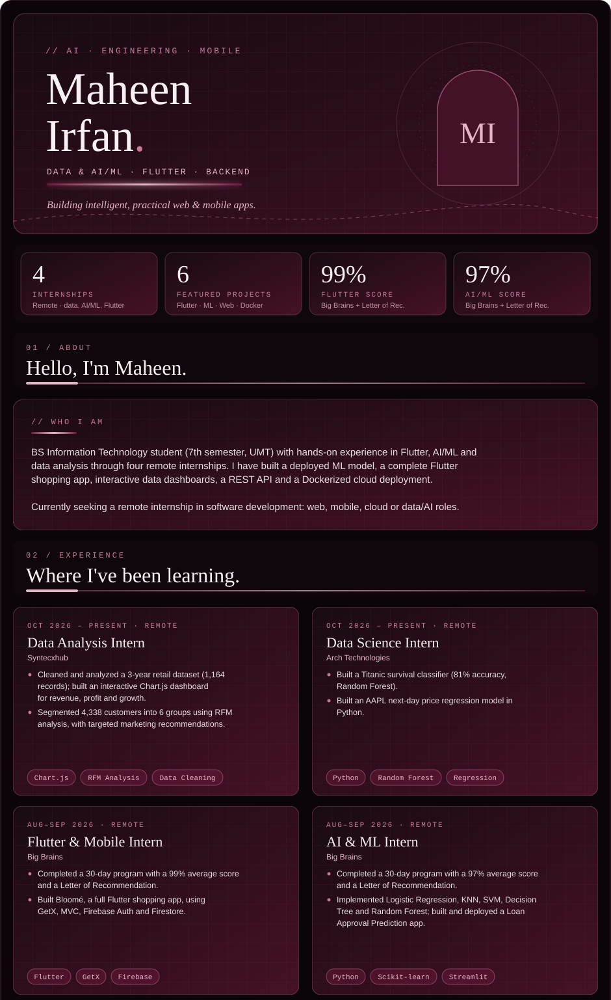</a>

<a href="https://github.com/maheenawan-dev/bloome-flower-bouquet-app">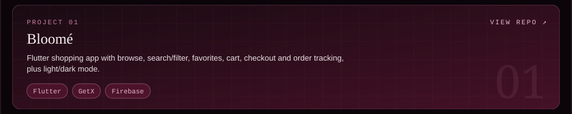</a>
<a href="https://github.com/maheenawan-dev/loan-approval-prediction">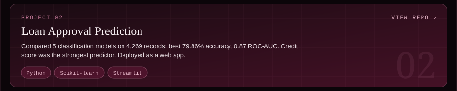</a>

<a href="https://github.com/maheenawan-dev/budgetlens-project1">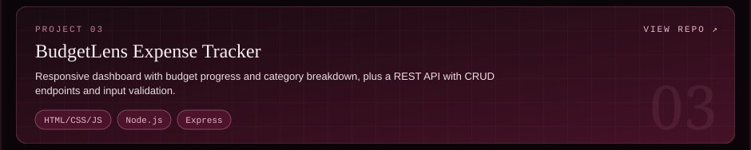</a>

<a href="https://github.com/maheenawan-dev/AIFaceMaskDetection">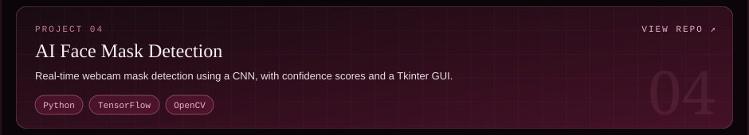</a>
<a href="https://github.com/maheenawan-dev/dockerized-2048-game">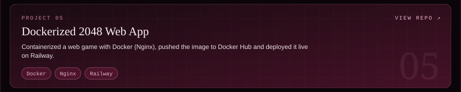</a>

<a href="https://github.com/maheenawan-dev/Travel-site">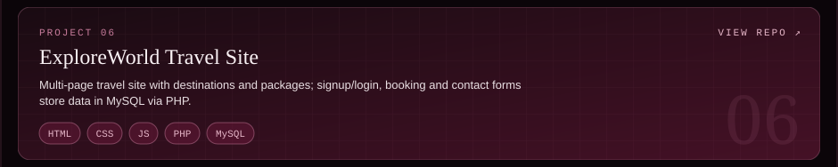</a>
<a href="https://github.com/maheenawan-dev">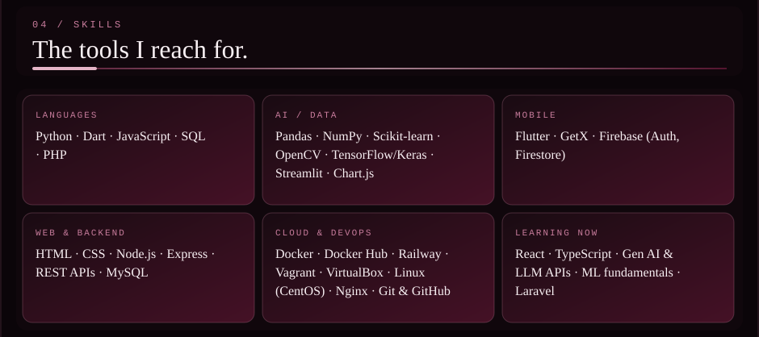</a>

<a href="https://github.com/maheenawan-dev">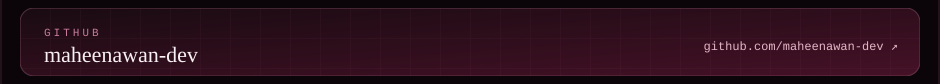</a>
<a href="https://maheenawan-dev.github.io/maheen-portfolio">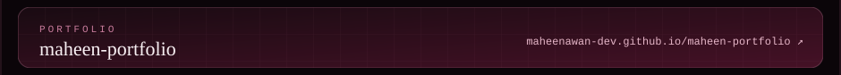</a>
<a href="https://maheenawan-dev.github.io/maheen-portfolio">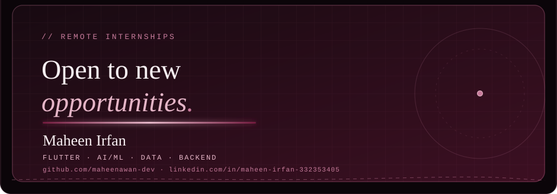</a>
